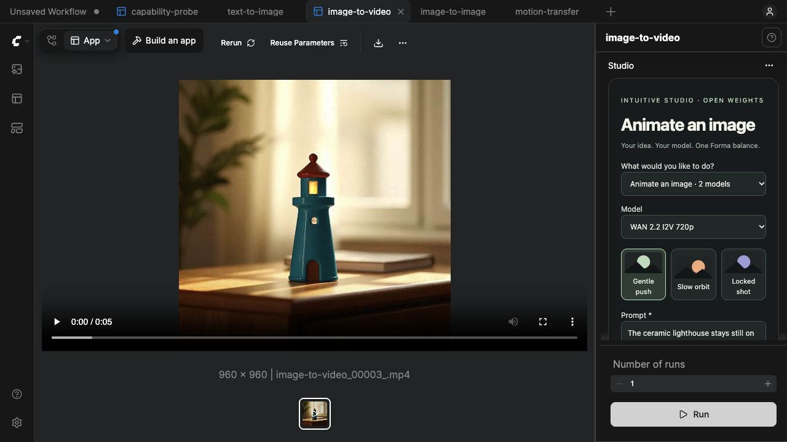
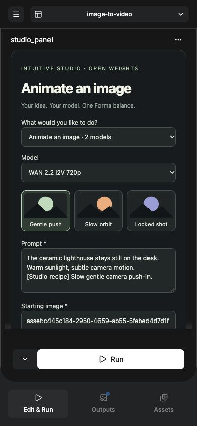
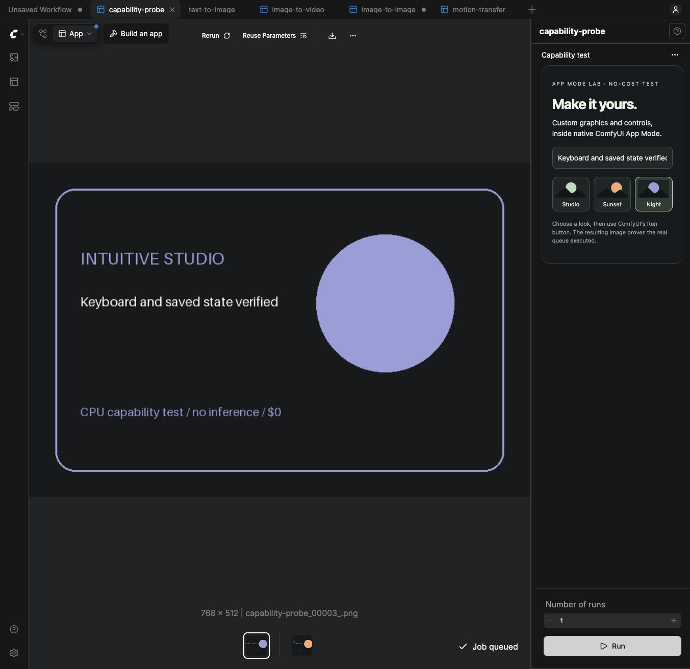

# Verification record

Completed 2026-10-30 against actual ComfyUI 0.43.0 / frontend 1.57.6 on macOS
arm64, using the CPU runtime and the mandatory Forma → Runpod inference path.

## Passed

- **13 backend tests:** excluded models and fal routes, incompatible workflow/kind,
  malformed JSON, invalid numeric inputs, unverified LoRA/prompt enhancement,
  reservation before network, conservation after uncertain submission, reservation
  idempotency, recovery without a local purchase, unsupported duration, and distinct
  DOM-widget identities across the bundled workflows.
- **No-cost live integration:** all ten workflow templates and ten allowed models,
  invalid model/duration rejection, missing-header/cross-origin rejection, actual
  SaveVideo schema, and a real native queue probe returning a 768×512 image.
- **Native App Mode:** SVG graphics, model-specific fields, preset selection, price
  checks, actual native output viewers, and image → edit → animation hand-offs.
- **Persistence:** native Save, browser close/reopen, full backend restart, custom
  graphic choice, prompt, duration, owned asset reference, take and result reference.
- **Recovery:** the saved five-second video request recovered its original Forma
  job after backend restart; ledger remained four reservations totalling 80 cents.
- **Navigation:** graph → App Mode remount and switching existing workflow tabs.
  A blank-panel failure from shared node IDs was reproduced, fixed with distinct
  stable IDs, and regression-tested between the probe and video app.
- **Responsive:** 390×844 native Edit & Run / Outputs tabs; document width 390,
  custom panel width/scrollWidth both 346. No horizontal overflow.
- **Keyboard:** labelled preset button activated by keyboard and a no-cost probe
  rendered the selected state. Form edits update serialized state immediately.
- **Uploads:** local generated PNG uploaded through the App Mode file picker to
  Forma and returned an owned asset reference. No inference was purchased.
- **Unavailable workflow:** motion transfer remains visible with an explanation;
  native Run was rejected by the server without another ledger reservation.
- **Browser:** latest post-fix browser session had no recorded console errors.
- JavaScript syntax checks and shell syntax checks pass. Launch script tested from
  the durable project directory with the existing Python dependency environment.

## Live inference receipts

| Test | Endpoint | Forma status | Reported cost | Conservative reservation |
|---|---|---|---:|---:|
| Create lighthouse | FLUX.1 Schnell | COMPLETED | $0.01 | $0.01 |
| Edit lighthouse to teal | Qwen Image Edit 2511 | COMPLETED | $0.04 | $0.04 |
| Animate, unsupported 3 seconds | WAN 2.2 I2V | FAILED | null | $0.28 |
| Animate, documented 5 seconds | WAN 2.2 I2V | COMPLETED | $0.47 | $0.47 |
| **Total** | | | **$0.52 reported** | **$0.80 of $3 ceiling** |

The failed quote stays reserved locally; no refund assumption is needed to remain
within budget. These are Forma job cost fields, not an independent wallet audit.
Sanitized [machine-readable receipts](evidence/inference-receipts.json) include
exact job/endpoint IDs, status and reservations. No API keys or signed URLs.

The final video is a real H.264 MP4: 960×960, 161 frames, 5.367 seconds by ffprobe.
It is saved under `.runtime/data/output/IntuitiveStudio/image-to-video_00001_.mp4`.
Repeated recovery writes another local output file, not another paid generation.

## Known limits and upstream observations

- Schnell request and Forma job inputs recorded 512×512; the endpoint returned
  1024×1024. WAN request recorded 1280×720; the endpoint returned 960×960 for the
  square reference. The app reports actual output dimensions. No Forma code was
  changed to hide or fix these upstream behavior discrepancies.
- WAN 2.2 rejected 3 seconds. The app now restricts durations to documented
  5/8/10/15-second choices. Only five seconds was tested live.
- Four workflow types have compatible enabled entries. Six are preserved but
  await endpoints. Talking portrait and the other enabled model variants were
  not all exercised with paid jobs; allowlisting is not a claim of live testing.
- On backend restart, ComfyUI's in-memory result history clears. Output files and
  app result references persist. An unchanged Run recovers the existing Forma job.
- Model switches reset model-specific values, including media fields. Re-select
  the desired owned reference when switching models.
- Native Number of runs repeats the same Studio take. Use New take for a fresh
  paid generation; this intentionally avoids accidental batch purchases.
- The October run reused an existing ComfyUI Python environment. The November
  clean-install check below covers the standalone installer.
- This is a local trusted-user prototype. Public deployment/multi-user isolation,
  organizer acceptance and a competition submission are outside this verification.

## Standalone install verification, 2026-11-03

On Apple silicon, a fresh checkout with no runtime, Forma key or external
ComfyUI Python setting installed the pinned backend and frontend through
`./start.sh`. uv used Python 3.12.11 and its normal package cache. The installed
runtime occupied about 1.7 GiB. The first CPU startup took a few minutes.

The README’s direct template link opened Create in native App Mode. The first
visit showed ComfyUI’s welcome tour and the Studio form showed **Connect Forma ·
Not connected**. All 20 backend tests passed in the new environment. The live
probe checked ten workflows and ten allowed models and produced a 768 × 512
image with zero paid requests. A second setup passed with uv in offline mode.
Linux standalone installation has not been exercised in this verification.

## Results navigation, 2026-11-03

Browser checks used an existing image and an existing MP4 in isolated local
workflows. **Choose workflow → Back to results** restored the selected output
and form settings for both. Create → Edit → Create and Animate → Edit → Animate
also restored the respective output and settings. The video check covered WAN
image-to-video. Talking portrait shares its viewer and still awaits a separate
end-to-end test.

## Reproduce

Run `./start.sh`. With the standalone server running, use a second terminal in
the same checkout:

```sh
.runtime/venv/bin/python -B -m unittest discover -s tests -v
.runtime/venv/bin/python -B scripts/verify_runtime.py
```

Set `STUDIO_PORT` for the verification command if the server uses a custom port.
When reusing a ComfyUI environment, substitute its Python executable. The
integration check exercises rejected requests and saves one local probe image.






